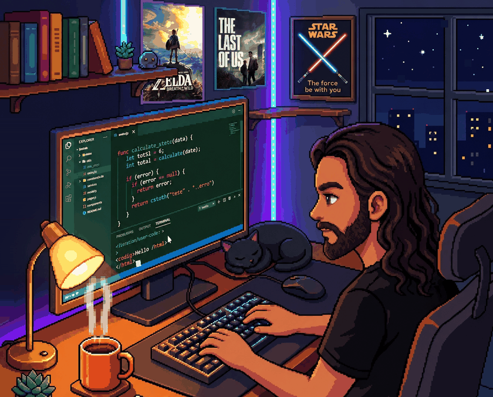

# Ralf Mota

**Analista de Sistemas | Java • Spring Boot • SQL**
Graduando em TI (UFMS) · Campo Grande, MS

*café, código e um gato de plantão* ☕🐈‍⬛

---

## Sobre mim

Analista de sistemas com mais de 6 anos de atuação em suporte e análise de sistemas corporativos e de gestão pública (prefeituras, SAP, SQL Server), com vivência próxima ao ciclo de desenvolvimento: reprodução e depuração de erros em ambiente de homologação, rastreamento de stored procedures, consultas SQL e levantamento de requisitos.

Hoje direciono essa bagagem para o desenvolvimento back-end com Java e Spring Boot.

- **Foco atual:** Java • Spring Boot • SQL (PostgreSQL / SQL Server)
- **Também uso:** HTML, CSS, JavaScript, Angular
- **Formação:** Tecnologia da Informação — UFMS (conclusão prevista: dez/2026)

## Stack

**Back-end e dados**

**Front-end e ferramentas**

## Projetos

| Projeto | O que é | Stack |
|---|---|---|
| [gerenciador-de-tarefas-fullstack](https://github.com/RalfMota/gerenciador-de-tarefas-fullstack) | API REST de tarefas com front-end em Angular (listagem funcionando; cadastro em desenvolvimento) | Java 17, Spring Boot, JPA, Angular |
| [ecocoleta](https://github.com/RalfMota/ecocoleta) | Plataforma de coleta seletiva: protótipo de front-end e modelagem relacional completa (DDL, seed e consultas) | Vue, PostgreSQL |

## Em andamento

- Concluir o cadastro de tarefas e evoluir para persistência em banco relacional
- Transformar o ecocoleta em uma API Spring Boot, com relatório por período

